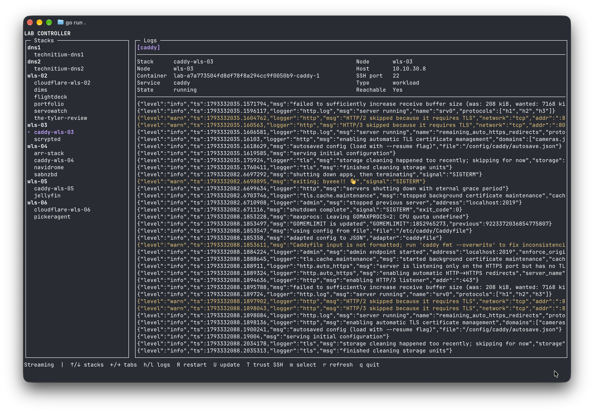

# Lab Controller

Lab Controller deploys Docker Compose stacks to lab hosts and manages PostgreSQL
databases through an HTTP API. A terminal interface shows stacks, containers,
logs, node status, and database information. GitHub Actions can build images and
submit deployments to the controller.



## How it works

The API reads a node configuration at startup and connects to workload and
database hosts over SSH as `controller`. It records deployment jobs and stack
metadata in SQLite. Database credentials are encrypted in that database; the
encryption key must be retained to recover them. Removing a node from the
configuration removes its controller records on the next startup, while leaving
the host's workloads, databases, and backup files in place.

A deployment supplies a `.forearm` file naming the target stack and node,
Docker Compose configuration, and optional JSON environment and secret values.
The API returns job IDs when it accepts the request; poll the jobs to determine
whether deployment succeeded. PostgreSQL databases and backup schedules are
optional. Existing MySQL or other external databases can be used without a
controller-managed database.

## Getting started

1. Build and publish the API image and prepare SSH access to the API, workload,
   and database hosts. Hosts need Docker and Compose; workload hosts must be
   able to pull their images. The commissioning scripts expect SSH aliases that
   connect to a user with sudo access. Create an SSH key pair at
   `~/.ssh/lab_controller` and `~/.ssh/lab_controller.pub` if needed:

   ```sh
   ssh-keygen -t ed25519 -f ~/.ssh/lab_controller
   ```

2. Create the local API Compose configuration from the tracked example:

   ```sh
   cp src/api/compose/docker-compose.yml.example src/api/compose/docker-compose.yml
   ```

   Set the image in that file to your published image if needed. Create
   `src/api/compose/.env` with the following values, replacing the examples:

   ```dotenv
   DB_ENCRYPTION_KEY=<64-hex-character-key>
   BACKUP_NFS_SERVER=192.0.2.10
   BACKUP_NFS_EXPORT=/exports/backups
   ```

   Generate a key with `openssl rand -hex 32`. Keep the key and SQLite data
   safe: the same key is required to recover stored credentials. Configure an
   NFS export accessible to the API host and writable by the container. Compose
   reads the NFS values from `.env` when it starts on the API host. The local
   Compose file and `.env` are ignored by Git.
3. Run the appropriate commissioning scripts from your local machine, using SSH
   aliases for the hosts:

   ```sh
   ./scripts/commission-api-host.sh <ssh-host-alias>
   ./scripts/commission-workload-host.sh <ssh-host-alias>
   ./scripts/commission-database-host.sh <ssh-host-alias>
   ```

   The scripts use `~/.ssh/lab_controller` and its `.pub` file. The database
   host is only needed for controller-managed PostgreSQL databases.
4. Create `nodes.yaml` in `~controller/stacks/api` on the API host. The API
   host commissioning script does not create it. For example:

   ```yaml
   workload_hosts:
     - name: worker-01
       hostname: 192.0.2.10
       ssh_port: 22
   database_hosts:
     - name: db-01
       hostname: 192.0.2.11
       ssh_port: 22
       postgres_port: 5432
   ```

5. Start the API Compose stack on its host as `controller`, then check `/health` and `/nodes`:

   ```sh
   cd ~/stacks/api
   docker compose up -d
   curl http://localhost:8080/health
   curl http://localhost:8080/nodes
   ```

   Use the [example project](docs/example_project/README.md) to configure a
   deployment and GitHub Actions workflow.

The API has no authentication and exposes database credentials. Restrict access
to trusted networks and runners. Its first SSH connection trusts the presented
host key; subsequent changes are rejected unless explicitly trusted.

## Terminal interface

With Go 1.24 or later installed:

```sh
cd src/tui
go run . -api http://<controller-host>:8080
```

Use the arrow keys to navigate stacks and container or database tabs. `R`
restarts a container, `U` updates a stack, `D` deletes a stack after two confirmations, `T` trusts a replacement SSH host
key, and `r` refreshes. See the [TUI guide](src/tui/README.md) for all controls.

## Development

```sh
cd src/api && go test ./...
cd ../tui && go test ./...
```

The [API guide](src/api/README.md) documents endpoints, deployment requests,
backup schedules, and storage. The ignored `src/http/` directory can hold local HTTP requests. The repository also contains
`scripts/` for host commissioning, `src/api/compose/` for the API
host stack, and `src/dbserver/` for the PostgreSQL host stack.
